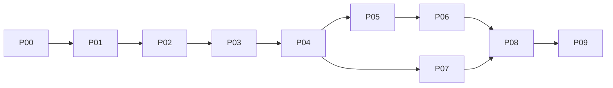

# Kế hoạch chính — FoodOrderNext

Phiên bản **1.8** · Lập ngày **2026-11-03**, cập nhật **2026-11-21** · Nhóm **3 người**.

Đây là kế hoạch chính để triển khai dần. Tài liệu phase mô tả chi tiết đầu việc, `BACKLOG.csv` giữ trạng thái task và `PROGRESS.md` ghi điểm dừng. P01–P07 có bản local. Xem [tiến độ và bằng chứng](PROGRESS.md).

## 1. Mục tiêu sản phẩm và kết quả cần đạt

Nâng dự án đặt món cũ thành ứng dụng đặt/giao đồ ăn trong khuôn viên trường: khách đặt món, quán xử lý, shipper được phân công giao, khách theo dõi và đánh giá. Ba thiết bị có thể thao tác trên cùng một đơn và nhận thay đổi thật. Hai tính năng AI phục vụ hai nhu cầu khác nhau của khách và quán.

Tiêu chí thành công:

- Tối thiểu 20 màn hình có chức năng thật; inventory thiết kế hiện gồm 37 màn hình xác thực/nghiệp vụ và 4 UI tiện ích trong `SCREEN_MAP.md`. Có thể gộp khi triển khai; không coi 41 là số được giảng viên bảo đảm công nhận và không đếm trùng để tăng số.
- Firebase là database chính; dữ liệu nghiệp vụ thật nằm trong Firestore, không chỉ dùng Firebase để đăng nhập hoặc gửi push.
- Tương tác realtime hai chiều có bằng chứng: chat theo đơn, thao tác quán/shipper và listener cập nhật cho các bên liên quan.
- Ít nhất hai AI tích hợp thật: trợ lý chọn món và phân tích đánh giá.
- Tối ưu query/index/pagination/cache/lazy loading/batch có số đo và Firebase Performance Monitoring thật.
- Có bản Android cài mới được, bộ dữ liệu demo tái tạo, tài liệu và 10–15 slide.

Nguồn và diễn giải chi tiết: [REQUIREMENTS](REQUIREMENTS.md), [SOURCES](SOURCES.md). Phân công nhóm không tự thay thế cách chấm cá nhân trong PDF.

## 2. Phạm vi đã chốt

| Phần | Phạm vi lõi |
|---|---|
| Khu vực | Một khuôn viên/khu vực nhỏ, 1–3 quán demo |
| Client | Một app React Native, navigation theo role; Android nghiệm thu trước |
| Vai trò | customer, merchant, driver, admin tối thiểu |
| Xác thực | Firebase Auth email/password + xác minh email; chuyển Google login khi cấu hình đã sẵn |
| Database | Firestore chính; Storage ảnh; không triển khai MySQL/SQL Server song song |
| Backend | Giữ Express cho giá, đơn, quyền, tồn món, voucher, AI; worker thông báo cùng package |
| Giỏ/đơn | Một quán mỗi giỏ, tối đa 20 dòng món, số lượng nguyên dương; tùy chọn món đơn giản nếu có dữ liệu rõ ràng |
| Tiền | VND số nguyên, server tính tổng và lưu snapshot giá |
| Thanh toán | COD; hoàn tất giao và ghi xác nhận thu COD theo cùng thao tác server |
| Giao hàng | Merchant/admin phân công tài xế đã được duyệt; GPS foreground, bản đồ và thời điểm cập nhật cuối |
| Giao tiếp | Chat chữ theo đơn, lịch sử tin nhắn, thông báo trong app và FCM |
| AI 1 | Nhập nhu cầu/ngân sách → gợi ý từ tập món có thật, còn bán; server kiểm tra đầu ra |
| AI 2 | Phân tích đánh giá sau đơn hoàn tất → chủ đề/cảm xúc/tóm tắt, dẫn về đánh giá nguồn |
| Quản trị | Xem/tìm/lọc tài khoản, bật/tắt hoạt động; cấp quyền có kiểm soát từ backend |
| Báo cáo | Đơn/doanh thu theo ngày của quán, theo đơn COMPLETED và COD đã xác nhận |

Người dùng không tự đăng ký làm merchant/driver/admin. Tài khoản mới mặc định customer; admin bootstrap qua quy trình server của P01.

Ngoài phạm vi lõi: nhiều khu vực/chi nhánh, đối soát tài chính marketplace, tự ghép tài xế, GPS nền, dự báo ETA bằng mô hình, thanh toán tiền thật, loyalty, group ordering, ba app riêng, trang admin web riêng, microservices, AI tự đặt đơn. Chỉ xem xét sau khi P09 đạt hoặc có thay đổi phạm vi được ghi lại.

## 3. Tận dụng dự án cũ

Snapshot đã đọc: `1bc4eabed01d1b975a60cf8e66396888a4538b07` tại repository nguồn. Kết luận đọc code, chưa xác nhận runtime:

- Có React Native, React Navigation, Zustand, Axios và Express; database dùng driver `mssql` cho SQL Server.
- 27 file màn hình; cần phân biệt file UI với màn đã hoàn thiện nghiệp vụ.
- Tracking dùng courier/ETA/status cố định; recommendation hiện ngẫu nhiên; notification/settings còn placeholder.
- Giá đơn hiện nhận từ client; endpoint cập nhật trạng thái chưa có kiểm tra role/transition đầy đủ.

Giữ components, theme và UI phù hợp; thay service layer, auth, persistence, trạng thái và các placeholder. Không viết lại toàn bộ giao diện, không sao chép `node_modules`, secret hoặc dữ liệu cá nhân. Đường nhập source và migration: [MIGRATION](MIGRATION.md).

## 4. Các quy tắc xuyên suốt

1. **Giá và quyền thuộc server.** Client gửi ID món/số lượng, không quyết định tổng tiền, role, tồn kho, thời điểm hoặc trạng thái cuối.
2. **Đơn nguyên tử.** Tạo PENDING giữ suất món và quota voucher trong transaction; snapshot món/giá được lưu trong đơn. Có idempotency key và kiểm tra payload; không gửi FCM/gọi AI bên trong transaction.
3. **Trạng thái có kiểm soát.** Luồng chuẩn: `PENDING → ACCEPTED → PREPARING → READY_FOR_PICKUP → DELIVERING → COMPLETED`. `CANCELLED`/`REJECTED` là nhánh kết thúc từ PENDING. Khách chỉ hủy PENDING; quán từ chối PENDING. Hoàn kho/quota đúng một lần.
4. **Phân công riêng trạng thái đơn.** `assignmentStatus` tách khỏi status; shipper đã được gán và nhận chuyến mới xác nhận lấy món để chuyển READY_FOR_PICKUP → DELIVERING. Không thêm trạng thái PICKED_UP riêng trong v1.
5. **Quyền ở hai biên.** API kiểm tra ID token + user active/role/owner; Firebase client chịu Security Rules và truy vấn đúng phạm vi. Admin SDK bỏ qua Rules nên cần test API riêng.
6. **Không giả thành công khi offline.** Có thể xem cache, lưu giỏ; đặt/hủy/chuyển trạng thái chỉ thành công sau server xác nhận. Chat pending phải phân biệt với đã gửi; không để optimistic UI ghi đè trạng thái mới.
7. **GPS có giới hạn.** Chỉ tài xế được gán ghi khi giao và app foreground; dừng khi kết thúc; hiển thị dữ liệu cũ và từ chối quyền hợp lý.
8. **Hai AI thật.** Có model/API thật, schema đầu ra, dữ liệu nguồn, bộ đánh giá và fallback được gắn nhãn. Kết quả fallback không được báo là AI vừa chạy thành công.
9. **Chỉ số trung thực.** Mục tiêu p95 hoặc dataset là giả thuyết nghiệm thu nội bộ; không ghi là đạt khi chưa đo trên môi trường đã nêu.
10. **Dữ liệu demo an toàn và tái tạo.** Dùng tài khoản/dữ liệu giả, seed có mã phiên bản; không sử dụng lịch sử đơn/vị trí thật của người khác.

## 5. Lộ trình 10 phase

P00–P07 đã bắt đầu. P01 còn nghiệm thu trên Firebase thật. P02–P06 triển khai luồng khách, COD, vận hành quán, realtime, chat, GPS foreground và hộp thư. P07 kiểm thử hai luồng AI trên Ollama local. Firebase Performance, FCM staging và GPS thực vẫn cần nghiệm thu. Xem PROGRESS và BACKLOG để biết kết quả từng hạng mục.

| Phase | Kết quả chính | Phụ thuộc | Đầu mối | Checklist |
|---|---|---|---|---|
| P00 | Import baseline có kiểm soát; build Android; chứng minh Auth/listener/perf/native/AI khả thi | Không | ALL | [Foundation](phases/P00-foundation.md) |
| P01 | Firebase Auth, role/active, schema, seed, rules/API skeleton và mapping UID | P00 | ALL, C điều phối | [Auth & data](phases/P01-auth-data.md) |
| P02 | Catalog/phân trang, tìm kiếm, profile/địa chỉ, cart/favorite, settings/support thực | P01 | A | [Customer](phases/P02-customer.md) |
| P03 | Server tạo đơn, tồn/voucher/idempotency, snapshot, lifecycle/COD/review | P01, phần catalog P02 | A+B | [Order engine](phases/P03-order-engine.md) |
| P04 | Menu/quán, queue/order detail, phân công driver, admin tối thiểu và báo cáo | P03 | B | [Merchant/admin](phases/P04-merchant-admin.md) |
| P05 | Realtime đúng scope, chat hai chiều, FCM/outbox/deep link và reconnect | P03, queue P04 | C | [Realtime](phases/P05-realtime-chat-notifications.md) |
| P06 | Chuyến đã gán, xác nhận lấy/giao, GPS foreground, bản đồ và stale marker | P04, core realtime P05 | C | [Driver](phases/P06-driver-tracking.md) |
| P07 | Hai AI độc lập, có UI/API, grounding/validation và bộ đánh giá | P02–P04; review fixture có kiểm soát | A+B | [AI](phases/P07-ai.md) |
| P08 | Regression quyền/nghiệp vụ, dữ liệu lớn, đo tối ưu, kiểm tra native thiết bị thật | P02–P07 | ALL | [Hardening](phases/P08-hardening-performance.md) |
| P09 | APK demo, setup/reset, 10–15 slide, video và rehearsal cá nhân | P08 | ALL | [Release/demo](phases/P09-release-demo.md) |

P05 không có nghĩa đến đó mới viết listener: listener nền được thử ở P00/P01 và hàng đợi ở P04. P08 cũng không có nghĩa dồn test/perf đến cuối; mỗi phase đã có test và evidence.

P07 có thể phát triển song song P05/P06 sau khi catalog, review schema và API đã ổn định; review AI có thể dùng fixture COMPLETED trong development, nhưng nghiệm thu cuối phải dùng cả review tạo qua luồng thực. C có thể spike maps/native ngay P00 mà không chờ đơn hoàn chỉnh.

## 6. Mốc nghiệm thu

| Mốc | Khi nào | Chứng minh tối thiểu |
|---|---|---|
| M0 | Hết P00 | Android build; Auth → Express; hai client nhận thay đổi; trace perf thật; xác định cấu hình maps/AI/FCM |
| M1 | Hết P01 | Phân quyền thực, seed lặp lại được, không tự nâng role, test API và Rules đầu tiên |
| M2 | Hết P03 | Đặt đơn giá server, chống trùng, không âm tồn, snapshot, hủy/hoàn đúng một lần |
| M3 | Hết P05 | Quán nhận đơn và khách thấy trạng thái; chat hai chiều; notification không làm sai nguồn dữ liệu |
| M4 | Hết P06/P07 | Ba vai trò chạy đến hoàn tất/COD/review; GPS foreground; cả hai AI hoạt động |
| M5 | Hết P08 | Bảng test có kết quả, lỗi nghiêm trọng được xử lý, số đo trước/sau đúng điều kiện |
| M6 | Hết P09 | Cài mới từ hướng dẫn thành công, demo/rehearsal, APK/slides/video và mapping requirement |

Phase chỉ DONE khi đầu ra và cổng nghiệm thu đều đạt, có bằng chứng. Chỉ tạo màn hình hoặc viết endpoint chưa đủ.

## 7. Nhân lực, lịch và ưu tiên

Giả định lập kế hoạch: ba người đã biết React căn bản, có thiết bị Android và dành **12–15 giờ/người/tuần trong 10 tuần** (~360–450 giờ công nhóm). Đây là ước lượng cần hiệu chỉnh sau P00, không phải deadline hoặc cam kết. Nếu thời gian thực ít hơn, giảm phạm vi theo `RISKS.md`, không bỏ yêu cầu Firebase/2 AI/realtime/perf.

- A: khách/catalog/checkout + AI chọn món; B: quán/order engine/báo cáo + AI phản hồi; C: driver/native/realtime/FCM/build.
- Tất cả cùng thiết kế auth/schema và review chéo. Không có người chỉ làm UI hoặc chỉ làm database trong toàn đồ án.
- Ưu tiên `CORE` cho yêu cầu bắt buộc và luồng lõi; `ENHANCEMENT` chỉ kéo sau các cổng lõi.
- Theo dõi 10 tuần tương đối, không gắn ngày lịch khi chưa có deadline. Chi tiết tại [TEAM_AND_DELIVERY](TEAM_AND_DELIVERY.md).

## 8. Quy trình thực hiện từng task

1. Chọn task `READY` hoặc `NOT_STARTED` có dependency đạt; xác định owner và acceptance.
2. Đọc contract và viết lát cắt có thể demo; cập nhật test có ý nghĩa cho nghiệp vụ/quyền.
3. PR nhỏ theo task, một thành viên khác review; thay contract phải có migration/compatibility rõ.
4. Lưu evidence theo `artifacts/evidence/Pxx/<task-id>/`; không commit secret/raw token.
5. Cập nhật `BACKLOG.csv`, checkbox phase và `PROGRESS.md` cùng phiên. `DONE` cần evidence và test result.
6. Ghi việc còn lại, lý do blocked, quyết định và task kế tiếp. Khi user yêu cầu phase tiếp theo, đọc lại tiến độ thay vì bắt đầu từ đầu.

Trạng thái task: `NOT_STARTED`, `READY`, `IN_PROGRESS`, `IN_REVIEW`, `DONE`, `BLOCKED`. `BLOCKED` phải ghi nguyên nhân cụ thể; không dùng để che việc chưa bắt đầu.

## 9. Nghiệm thu cuối và tài liệu cần giao

- Ma trận yêu cầu PDF có đường dẫn evidence.
- APK Android cài mới được; phiên bản/commit build và môi trường được ghi.
- Hướng dẫn setup, cấu hình secrets bằng biến môi trường, emulator/staging và seed/reset.
- Kiến trúc, data model/index/rules, API hợp đồng và state machine đã cập nhật theo code cuối.
- Test report: nghiệp vụ, Rules, API, realtime, GPS, native push/perf, hai AI.
- Dataset/seed định danh; số đo trước/sau, thiết bị/mạng/sample size; không lấy tốc độ emulator làm production benchmark.
- Slide 10–15 trang (đề xuất 12), video dự phòng, tài khoản demo giả và kịch bản ba thiết bị.
- Nhật ký đóng góp/PR/test của từng người và phần hạn chế còn lại.

Kịch bản chính: khách đặt → quán nhận/chế biến → gán shipper → nhận chuyến/lấy món → theo dõi → giao + COD → đánh giá → hai AI. Kịch bản phụ: sửa giá client, checkout trùng, tranh suất cuối, sai quyền/sai trạng thái, mất mạng/kết nối lại.

## 10. Thứ tự triển khai từ hiện tại

Ưu tiên kiểm thử các luồng đã tích hợp trên môi trường local. Xếp nghiệm thu đa thiết bị và Firebase staging sau đợt kiểm thử, tối ưu local.

| Đợt | Việc ưu tiên theo thứ tự | Đầu ra |
|---|---|---|
| **1. Kiểm thử quyền và luồng đơn local** | Chạy **P08-T07** và **P08-T08** trước. Kiểm tra quyền ở API và Firebase Rules, giá do server tính, đặt trùng, tranh suất cuối, hoàn tồn/voucher và ghi giao hàng cùng thu COD. Chạy lại chat, kết nối lại và AI fallback. Mở danh sách lỗi theo **P08-T09**, sửa ngay lỗi chặn và kiểm thử lại. | Bảng kết quả trên local, log và danh sách lỗi đã xác minh. |
| **2. Đo và tối ưu local** | Chuẩn bị dữ liệu mẫu có thể tạo lại (**P08-T01**), ghi số đo ban đầu (**P08-T02**) rồi xử lý các điểm chậm đã đo được ở truy vấn, giao diện và listener (**P08-T03–T05**). | Bộ dữ liệu và cấu hình đo, bảng trước/sau cùng điều kiện, bản hoặc mã nguồn tương ứng với mỗi lượt đo để chạy lại khi cần. |
| **3. Nghiệm thu còn mở** | Tái tạo cài đặt trên máy thành viên thứ hai và đối chiếu bằng chứng P07 cho mục thử nghiệm AI **P00-T07**. Khi nối lại phần staging và đa thiết bị, kiểm tra realtime, push FCM, GPS và trace Performance Monitoring (**P08-T06**) theo checklist từng phase. | Bằng chứng theo môi trường và thiết bị, kết quả review chéo P00–P06, báo cáo P08 với lỗi chặn đã xử lý. |
| **4. Phát hành và demo** | Sau khi qua cổng P08, hoàn tất **P09** gồm APK cài mới, tài liệu đối chiếu yêu cầu, slide, video và diễn tập. | Bản Android ứng viên và bộ bàn giao đồ án. |

Trong đợt 1, A kiểm luồng khách và đặt món, B kiểm transaction và quyền quán, C kiểm quyền tài xế, Rules, chat và kết nối lại. Nhóm dùng seed hiện có cho lượt hồi quy đầu tiên. Sau khi sửa lỗi chặn, dành bộ dữ liệu lớn để đo hiệu năng. Chi tiết từng task nằm trong [kế hoạch P08](phases/P08-hardening-performance.md); trạng thái và điểm dừng nằm trong [PROGRESS](PROGRESS.md).
